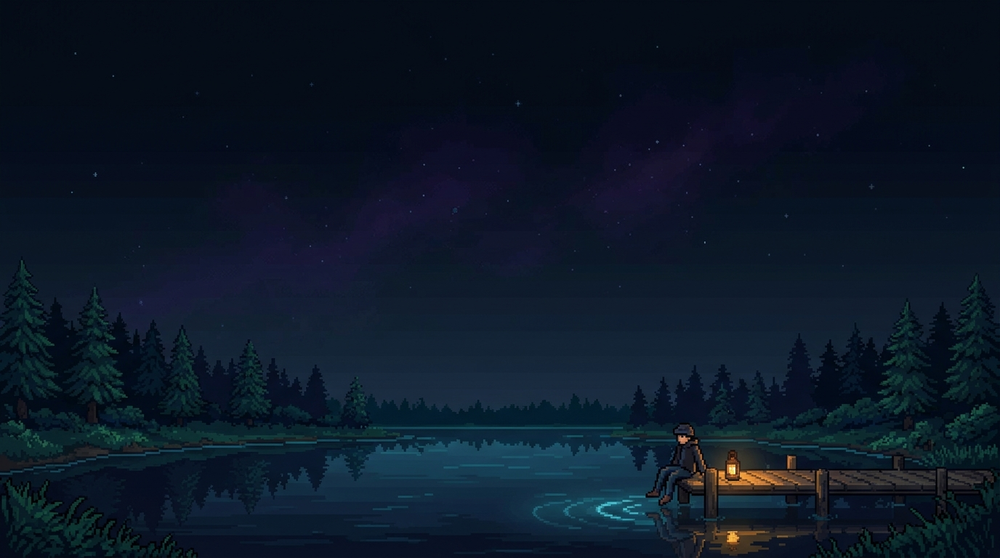

# 🌲 AINXE Studio

  <em>Where Calm Meets Code.</em>

 

  

> ### 💬 Quote
> 
> *"First, solve the problem. Then, write the code."*  
> — **John Johnson**  
> 
> *"Simplicity is prerequisite for reliability."*  
> — **Edsger W. Dijkstra**  
> 
> *"In a digital world drowned in noise, the ultimate sophistication is quiet durability. We don't just write code — we architect sanctuaries."*  
> — **AINXE Studios**

  

Crafted with quiet intention by <strong>AINXE Studios</strong>.

